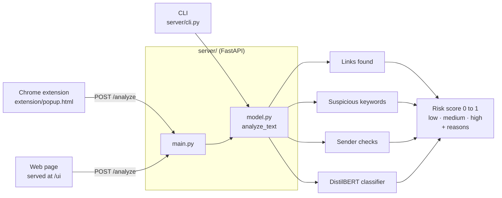

# AI-Based Phishing and Scam Detector (Prototype)

This repository contains a minimal prototype of an AI-based phishing and scam detector composed of:

- `server/` — FastAPI backend that analyzes text using a transformer-based classifier plus heuristics for links and suspicious keywords.
- `extension/` — A Chrome extension (Manifest V3) popup UI to paste messages, enter sender info, and get a risk analysis from the backend.

This is a starting point — the classifier is a prototype. For production use, train a dedicated model, add secure deployment, and follow privacy best practices.

## How it works



Each message gets a risk score between 0 and 1, built from four signals:

| Signal | How it adds to the score |
|---|---|
| Links | +0.2 per `http(s)` link, up to 1.0 |
| Suspicious keywords | +0.15 per word such as *urgent*, *verify*, *password*, *bank*, *wire transfer*, *SSN*, up to 1.0 |
| Sender | +0.2 if the address has four or more digits in a row; +0.1 for `@service`, `@no-reply` or `@noreply` |
| Classifier | A small nudge from a general DistilBERT sentiment model (a placeholder for a real phishing model) |

A score of 0.7 or more is **high** risk and 0.4 or more is **medium**. The response lists the reasons.

## Project layout

| Path | What it is |
|---|---|
| `server/main.py` | FastAPI app: `POST /analyze` (text + optional sender → score, level, reasons) and `POST /report` (accepts a user report; prototype only). Also serves `frontend/` at `/ui`. |
| `server/model.py` | The scoring logic described above. |
| `server/cli.py` | Analyze `.eml` or `.txt` files from the command line. |
| `extension/` | Manifest V3 popup ("PhishGuard Prototype"). `content_script.js` is a placeholder for adding buttons to webmail later. |
| `frontend/` | The same form as a plain web page, at http://localhost:8000/ui once the server is running. |
| `results.json` | Sample CLI output. |

## Quick start (macOS / zsh)

1. Create and activate a Python virtualenv, then install server deps:

```bash
python3 -m venv .venv
source .venv/bin/activate
pip install -r server/requirements.txt
```

2. Run the backend server:

```bash
uvicorn server.main:app --reload --port 8000
```

3. Load the extension in Chrome/Edge/Brave:

- Open `chrome://extensions`
- Enable "Developer mode"
- Click "Load unpacked" and choose the `extension/` directory

4. Open the extension popup, paste an email or SMS text, enter sender, and click "Analyze".

## Notes

- This prototype uses a general text-classification transformer as a placeholder. Replace with a trained phishing classifier for higher accuracy.
- For privacy, consider on-device inference or an encrypted server. Avoid sending user-sensitive data without consent.

## CLI: analyze files locally

If you'd rather analyze local email files, there's a simple CLI tool that uses the same analyzer.

Run:

```bash
source .venv/bin/activate
python server/cli.py /path/to/email.eml
# or analyze all .eml/.txt files in a folder and write JSON output
python server/cli.py /path/to/emails/ --json results.json
```

The CLI will print a short verdict for each file: `SCAM`, `POTENTIAL`, or `OK`, along with a numeric risk score and reasons.

## Known limits

- The classifier is a general sentiment model, not a phishing model, so most of the score comes from the heuristics.
- The extension calls `http://localhost:8000` directly, so the server must be running on the same machine.
- `/report` doesn't store anything yet.
- The API has no authentication and allows requests from any origin. Keep it local.
